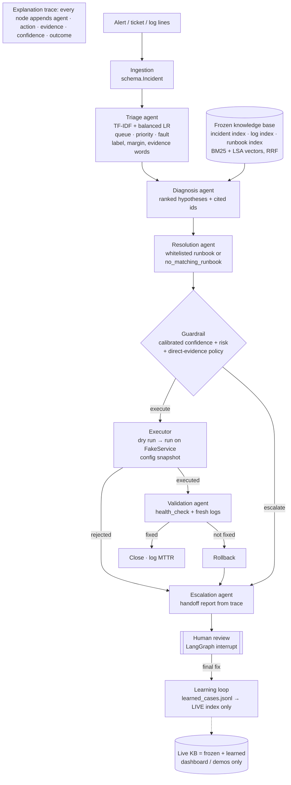

# Architecture

## Files

| Component | File |
|---|---|
| Incident + trace schema, stuck point | `schema.py` |
| Simulator (fake checkout API, whitelist, ground-truth fix table) | `sim/service.py` |
| Incident generator (1,200, 15% ambiguous, 70/15/15, seed 42) | `generate_incidents.py` |
| Ticket preparation, ServiceNow resolution times | `data_loader.py` |
| Triage agent / training | `agents/triage.py`, `train_triage.py` |
| Hybrid index (BM25 + vectors + RRF) | `rag/index.py` |
| Drain parsing + Loghub chunks | `rag/logparse.py` |
| Knowledge base (frozen / live), manifest hash | `rag/store.py` |
| Diagnosis agent (rules + retrieval + citation filter) | `agents/diagnosis.py` |
| Runbooks (12, with risk, preconditions, rollback) | `runbooks/__init__.py` |
| Resolution agent | `agents/resolution.py` |
| Guardrail + calibration | `guardrail.py`, `eval/calibrate.py` |
| Executor (dry run, rollback) | `executor.py` |
| Validation agent | `agents/validation.py` |
| Escalation agent / handoff | `agents/escalation.py` |
| LangGraph wiring, HITL interrupt | `graph.py` |
| Learning loop | `learning.py` |
| LLM wrapper (.env provider, optional) | `llm.py` |
| Dashboard | `app.py` |
| Demos | `demos/run_demos.py` |
| Evaluation | `eval/run_all.py`, `eval/metrics.py` |

## Key design decisions

* **Health is state, not a return value.** `FakeService.health_check()` is computed from the active fault;
  the Validation agent never trusts `apply_fix()`'s return value. "Resolved" in the metrics also requires the
  simulator to be healthy at the end (`verified_resolution_rate`).
* **Three independent blocks on unsafe actions:** runbook registry lookup, simulator whitelist, dry-run
  preconditions. High-risk runbooks are never auto-executed.
* **Confidence never comes from an LLM.** It is a logistic-regression calibration of triage margin, top
  retrieval similarity, hypothesis gap and top score (fit on out-of-fold train, thresholds tuned on val).
* **Direct-evidence policy.** The system never acts when no log line of the incident itself matches a
  signature of the diagnosed cause (`insufficient_evidence`). This is a fixed policy, not a tuned threshold.
* **Citations are checkable.** Every evidence item is an id: `<incident>:log:<n>`, `INC:…`, `LOG:…`, `RB:…`.
  LLM wording is kept only for sentences whose ids are all in the retrieved set (`keep_cited`).
* **Frozen evaluation index.** Built from train splits only; learned cases go to a separate file that only the
  live index reads. The manifest records doc counts and an id hash; tests assert no held-out ids are indexed.
* **State stays serialisable.** The simulator and KB live in a `Runtime` object outside the LangGraph state, so
  the in-memory checkpointer works for the human-in-the-loop interrupt.
